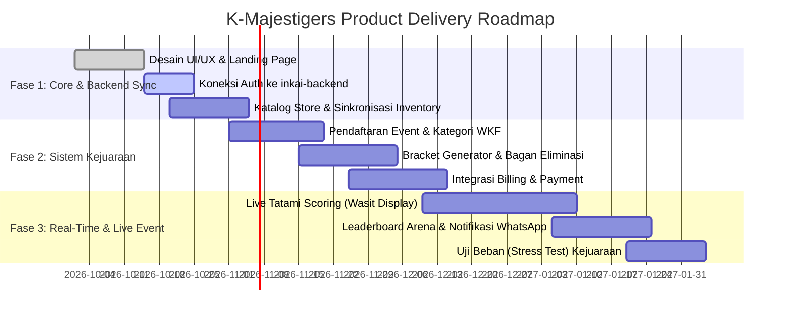
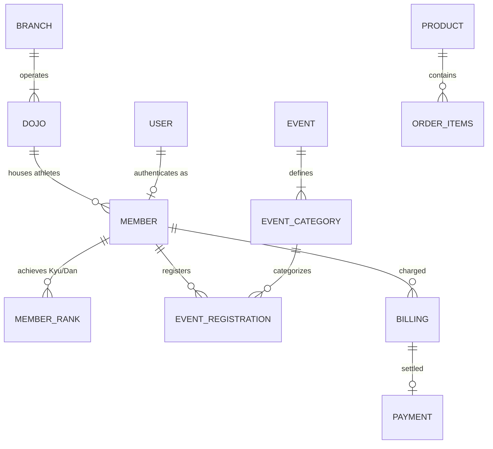
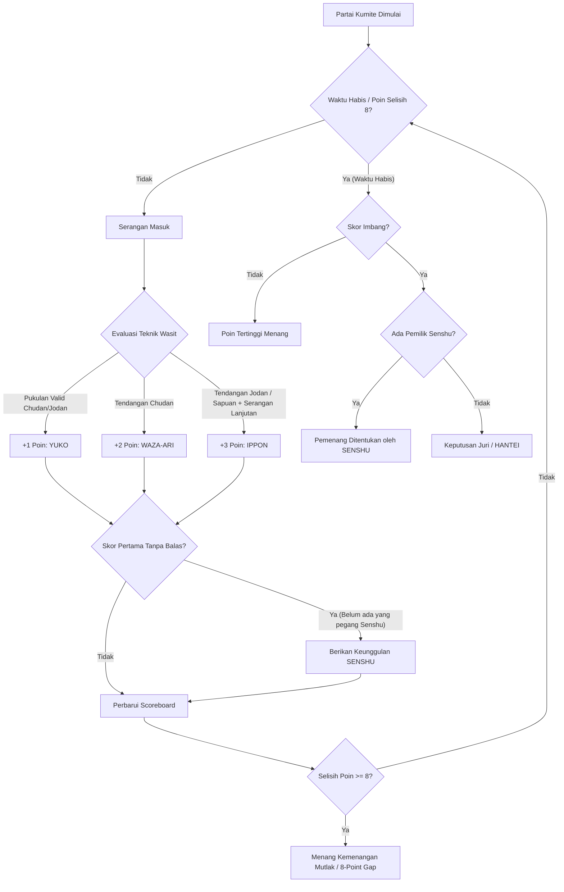

# Product Requirements Document (PRD)
## K-Majestigers: Elite Karate Academy & Championship Arena

---

| Metadata Dokumen | Detail |
| :--- | :--- |
| **Nama Produk** | K-Majestigers (Elite Karate Academy & Championship Arena) |
| **Versi Dokumen** | 1.0.0 |
| **Status** | Approved / Siap Implementasi |
| **Target Rilis MVP** | Q4 2026 |
| **Penulis** | Antigravity AI & Product Team |
| **Stakeholder Utama**| Manajemen Dojo K-Majestigers, Komite Pertandingan, Pelatih/Sensei, Atlet & Wali Murid |

---

## 1. Pendahuluan & Latar Belakang

### 1.1 Visi Produk
Menjadi ekosistem digital bela diri karate terintegrasi nomor satu di Indonesia yang menggabungkan:
1. **Manajemen Akademi Dojo Modern**: Pelatihan terstruktur standar World Karate Federation (WKF) dengan pelacakan kenaikan tingkat (*Kyu/Dan*) digital.
2. **Sistem Turnamen & Kejuaraan Real-Time**: Manajemen pendaftaran kontingen, jadwal matras, dan bagan pertandingan eliminasi langsung (*Live Brackets*).
3. **Official E-Commerce Store**: Akses resmi perlengkapan bertanding bersertifikasi WKF Approved (*Gi*, *protector*, dan apparel).
4. **Interactive Kumite Arena**: Simulasi interaktif berbasis web canvas untuk visualisasi teknik pertandingan dan edukasi strategi kumite bagi atlet muda maupun peminat umum.

### 1.2 Masalah yang Diselesaikan (Problem Statement)
* **Pencatatan Konvensional Dojo**: Riwayat sabuk atlet, kehadiran, dan jadwal ujian kenaikan tingkat (*gashuku*) sering kali tersebar secara manual di buku fisik atau chat WhatsApp.
* **Transparansi Turnamen**: Bagan pertandingan (*brackets*) kejuaraan karate di lapangan sering kali menggunakan kertas bagan dinding manual, menimbulkan kerumunan, keterlambatan informasi matras (*tatami*), dan rentan salah rekap.
* **Akses Perlengkapan Resmi**: Atlet dan wali murid kesulitan mencari perlengkapan karate berstandar WKF yang terjamin keasliannya dan terintegrasi dengan dojo mereka.
* **Keterlibatan Digital & Edukasi**: Kurangnya media interaktif yang menarik bagi generasi muda untuk memahami regulasi kumite (skoring *Yuko*, *Waza-ari*, *Ippon*).

---

## 2. Target Pengguna (User Personas)

| Persona | Profil & Kebutuhan | Peran di Platform |
| :--- | :--- | :--- |
| **1. Calon Anggota & Wali Murid** | Orang tua yang mencari dojo terpercaya untuk anak, atau individu yang ingin belajar karate. Memerlukan informasi kurikulum, jadwal latihan, dan kemudahan pendaftaran. | Pengunjung publik, pendaftar member baru, pembeli perlengkapan pemula. |
| **2. Atlet / Member Aktif** | Siswa dojo terdaftar (sabuk putih hingga hitam). Memerlukan tracking sabuk, jadwal ujian, riwayat kejuaraan, serta sertifikat digital. | Pengguna dashboard member, peserta turnamen. |
| **3. Manajer Kontingen / Pelatih** | Sensei/Pelatih klub eksternal maupun internal yang mendaftarkan puluhan atlet ke *K-Majestigers National Cup*. Membutuhkan batch registration dan pemantauan bagan live. | Pengelola kontingen, koordinator tim. |
| **4. Panitia & Wasit Juri (WKF)** | Petugas pertandingan yang mengatur jalannya kejuaraan di tiap tatami, menginput skor dan penalti (*Senshu*, *Hansoku*). | Administrator Turnamen / Operator Matras. |
| **5. Pengelola Dojo & Admin Toko** | Manajemen pusat K-Majestigers yang mengelola data siswa, pesanan merchandise, logistik, dan laporan keuangan. | Super Administrator & Store Manager. |

---

## 2.1 Arsitektur Role-Based Access Control (RBAC) & Pemisahan Area Pasca Login

Untuk menjamin keamanan, efisiensi operasional, dan privasi data antara atlet, pelatih dojo, dan panitia turnamen, sistem K-Majestigers membagi seluruh area pasca login menjadi **3 Portal Hak Akses Terpisah**:

```
                                 ┌─────────────────────────┐
                                 │     Autentikasi User    │
                                 │   (Email / NIA + Sandi) │
                                 └────────────┬────────────┘
                                              │
                      ┌───────────────────────┼───────────────────────┐
                      ▼                       ▼                       ▼
            [Role: MEMBER / ATLET]   [Role: DOJO_MANAGER]    [Role: SUPER_ADMIN / PANITIA]
                      │                       │                       │
                      ▼                       ▼                       ▼
               Portal Anggota          Portal Kontingen         Portal Admin/Panitia
             (member.html atau       (dojo.html atau          (admin.html atau
             /member/*)               /dojo/*)                 /admin/*)
                      │                       │                       │
         ┌────────────┴───────────┐ ┌─────────┴──────────┐   ┌────────┴──────────┐
         │ - Ringkasan Profil     │ │ - Dashboard Dojo   │   │ - Overview KPI    │
         │ - Status Sabuk Kyu/Dan │ │ - Roster 38 Atlet  │   │ - Bracket Gen 16+ │
         │ - QR Presensi Tatami   │ │ - Bulk Registration│   │ - Live Scoring    │
         │ - Riwayat Kejuaraan    │ │ - Invoice & Upload │   │ - Verifikasi Data │
         │ - e-Certificate PDF    │ │   Bukti Transfer   │   │ - Master Anggota  │
         │ - Jadwal Dojo & Match  │ │ - Live Tatami Call │   │ - Store Admin     │
         └────────────────────────┘ └────────────────────┘   │ - Report Excel/PDF│
                                                             └───────────────────┘
```

### Matriks Hak Akses & Matriks Otorisasi (Permission Matrix)

| Modul / Fitur Sistem | Anggota / Atlet (`MEMBER`) | Kontingen / Dojo (`DOJO_MANAGER`) | Super Admin / Panitia (`ADMIN`) |
| :--- | :---: | :---: | :---: |
| **Akses Dashboard Pribadi** | Full Access (Read/Edit Own) | Scoped ke Dojo Asal | Global Dashboard (Semua Dojo) |
| **Digital ID Card & QR Code** | Read & Download Own Card | Read & Print Roster Cards | Generate & Batch Print All Cards |
| **Riwayat Sabuk & UKT** | Read History & Ajukan Ujian | Rekomendasi & Update Massal | Pengesahan SK & Approval UKT |
| **e-Certificate Kejuaraan** | Download Milik Sendiri | Download Rombongan Dojo | Generate & Terbitkan Sertifikat |
| **Manajemen Roster Atlet** | Restricted (Data Diri Saja) | Full Access (Tambah/Edit Tim) | Full Master Directory Control |
| **Pendaftaran Turnamen** | Lihat Status Pendaftaran | Bulk Registration Rombongan | Pengaturan Kuota & Approval |
| **Verifikasi Pembayaran** | Read Tagihan Pribadi | Upload Bukti Transfer Kolektif | Approval & Validasi Keuangan |
| **Bagan Turnamen (Bracket)** | Read Only (Bagan Terbuka) | Read & Pantau Jadwal Tim | Create, Seed, & Edit Bracket |
| **Live Scoring Tatami Screen**| Read Only (Scoreboard) | Read Real-Time Status Tatami | Full Remote Tatami Operator |
| **Toko & Manajemen Pesanan** | Beli & Lacak Pesanan Sendiri | Pembelian Rombongan Perlengkapan | Input Produk, Stok, & Nomor Resi |
| **Ekspor Laporan (Excel/PDF)**| Unduh Sertifikat & ID Card | Unduh Rekap Kontingen Dojo | Unduh Data Peserta & Klasemen |

---

## 3. Cakupan Fitur & Kebutuhan Fungsional (Functional Requirements)

### Modul 1: Portal Publik & Profil Akademi (Web Showcase)
* **FR-1.1 Informasi Dojo & Kurikulum**: Menampilkan profil pelatih/Sensei berlisensi, tingkatan kurikulum (Kyu 10 hingga Dan), nilai-nilai Bushido, dan fasilitas dojo.
* **FR-1.2 Lokasi & Kontak Terintegrasi**: Informasi cabang (Jakarta, Surabaya, dsb.), tautan WhatsApp langsung, peta interaktif, dan media sosial resmi.
* **FR-1.3 Form Permohonan Info / Trial Class**: Formulir pendaftaran sesi latihan perdana gratis dengan notifikasi otomatis ke admin.

### Modul 2: Portal Anggota / Atlet (Member Area - `/member/*` -> `member.html`)
* **FR-2.1 Dashboard Utama**:
  * Ringkasan profil singkat (Nama, NIA, Cabang Dojo, status verifikasi).
  * Status sabuk aktif (Kyu/Dan) dengan progress bar kelayakan ujian Dan berikutnya.
  * Poin kehadiran latihan (persentase hadir 94%, total sesi 47/50, streak latihan).
  * Informasi event terdekat (K-Majestigers National Open 2026, nomor partai #42, tatami 2).
* **FR-2.2 Profil & Kartu Anggota Digital (Digital E-ID Card)**:
  * Kartu digital berdesain mewah emas/noir metalik lengkap dengan foto, NIA, dan barcode/QR Code untuk absensi dojo.
  * Biodata lengkap atlet (TTL, berat/tinggi badan, golongan darah, cabang dojo).
  * Riwayat kenaikan tingkat (*grading history* timeline dari Kyu 10 s/d Kyu 2).
  * Tombol cetak dan unduh e-ID Card format PDF/PNG.
* **FR-2.3 Riwayat Kejuaraan Saya**:
  * Daftar turnamen yang pernah diikuti beserta kelas tanding dan perolehan medali (Emas, Perak, Perunggu).
  * Tombol unduh *e-Certificate* resmi berstempel dan bertanda tangan digital Dewan Guru.
* **FR-2.4 Jadwal & Latihan**:
  * Jadwal kelas reguler di dojo (Kihon, Kata, Kumite, Fisik & Agility).
  * Jadwal tanding individu saat mengikuti kejuaraan (sudut Aka/Ao, perkiraan waktu, lawan).
  * Akses silabus materi latihan mingguan dan modul WKF.

### Modul 2B: Portal Kontingen / Dojo / Pelatih (Manager Area - `/dojo/*` -> `dojo.html`)
* **FR-2B.1 Dashboard Dojo**:
  * Statistik total atlet aktif binaan (38 karateka).
  * Total medali yang disumbangkan dojo (14 Emas, 9 Perak, 12 Perunggu - Peringkat 2 Klasemen Umum).
  * Status tagihan/pembayaran pendaftaran event (Invoice #INV-KM-2026-088: Rp 8.750.000, Lunas & Terverifikasi).
  * Jumlah atlet bertanding hari ini (12 atlet, dengan 4 atlet sedang on-mat/on-deck).
* **FR-2B.2 Manajemen Atlet (Roster Dojo)**:
  * Daftar seluruh atlet di bawah dojo tersebut dengan filter usia (Usia Dini s/d Senior) dan kelas berat.
  * Tombol tambah atlet baru ke roster dojo lengkap dengan input berkas.
  * Fitur update kategori berat badan dan pembaruan tingkat sabuk secara kolektif/massal.
* **FR-2B.3 Pendaftaran Event (Bulk Registration)**:
  * Wizard pendaftaran rombongan atlet ke kejuaraan dalam satu kali proses kalkulasi.
  * Pemilihan kategori (Kata/Kumite dan kelas berat) per masing-masing atlet.
  * Kalkulasi otomatis total biaya kontingen.
* **FR-2B.4 Keuangan & Pembayaran Kontingen**:
  * Rekap rincian total biaya pendaftaran event kontingen.
  * Upload bukti transfer kolektif (struk bank/QRIS) dan status verifikasi panitia.
  * Unduh kwitansi resmi lunas berstempel.
* **FR-2B.5 Jadwal Matras Atlet Dojo (Live Tatami Call Tracker)**:
  * Pemantau real-time 4 tatami dengan filter atlet dojo yang sedang *On Mat*, *On Deck (Warming Up)*, atau *Next Match*.
  * Indikator sudut (Aka Merah / Ao Biru) dan nomor partai.

### Modul 2C: Portal Admin / Panitia Kejuaraan (Admin Area - `/admin/*` -> `admin.html`)
* **FR-2C.1 Dashboard Utama (Overview)**:
  * Grafik statistik pendaftar kejuaraan secara real-time (42 dojo, 684 atlet).
  * Total pendapatan pendaftaran (Rp 184.500.000) dan merchandise toko (Rp 42.800.000).
  * Pintasan tindakan cepat (generate bracket, verifikasi bayar, umumkan partai, dsb.).
* **FR-2C.2 Manajemen Event & Pertandingan (Championship Control)**:
  * Pengaturan jadwal kejuaraan dan pembuatan kelas tanding umur & berat badan.
  * **Tournament Bracket Generator**: Generator bagan sistem gugur otomatis 16-besar s/d Final dengan algoritma seeding WKF dan klik untuk memajukan pemenang.
  * **Panel Live Scoring & Tatami Screen Controller**: Remote operator skor (+1 Yuko, +2 Waza-ari, +3 Ippon), Senshu, Chui/Hansoku C1-C4, dan timer 3:00 menit.
* **FR-2C.3 Verifikasi & Validasi Data**:
  * Menu persetujuan pendaftaran kontingen/atlet.
  * Verifikasi bukti pembayaran transfer bank dari dojo.
  * Validasi dokumen pendukung (akta kelahiran, surat dokter, ijazah untuk batas umur atlet).
* **FR-2C.4 Manajemen Anggota & Dojo**:
  * Direktori seluruh atlet, pelatih (Sensei), dan cabang dojo K-Majestigers se-Indonesia.
  * Hak menonaktifkan akun / suspend jika diperlukan.
* **FR-2C.5 Manajemen Toko & Merchandise**:
  * Pengelolaan katalog produk (Gi, sabuk, pelindung, body protector) dan input stok/harga.
  * Pemantauan pesanan member dan input nomor resi ekspedisi pengiriman.
* **FR-2C.6 Laporan & Rekapitulasi (Reports)**:
  * Unduh data peserta format Excel/CSV untuk akreditasi ID Card massal.
  * Generator e-Certificate massal.
  * Rekapitulasi perolehan Juara Umum Kontingen (Piala Bergilir K-Majestigers).

### Modul 3: Manajemen Kejuaraan & Live Brackets (Championship Arena)
* **FR-3.1 Publikasi Agenda Turnamen**: Halaman informasi detail kejuaraan (tanggal, venue, buku panduan teknis/THB, batasan usia & kelas berat badan kumite/kata).
* **FR-3.2 Pendaftaran Kontingen & Verifikasi Berkas**:
  * Formulir pendaftaran atlet individu dan regu kontingen.
  * Upload surat kesehatan dokter, akta kelahiran (verifikasi usia), dan bukti pembayaran.
* **FR-3.3 Bracket Generator Otomatis (Single Elimination / Repechage)**:
  * Generator bagan otomatis dengan algoritma seeding untuk mencegah bentrok sesama atlet satu dojo di babak awal.
  * Visualisasi bagan pertandingan bertahap (Penyisihan, Perempat Final, Semifinal, Bronze Match, Final).
* **FR-3.4 Live Scoreboard & Status Matras (Tatami Display)**:
  * Update skor real-time untuk kubu Aka (Merah) dan Ao (Biru).
  * Papan status laga: *Upcoming*, *In-Progress (Live)*, dan *Completed*.
  * Tampilan ringkas nomor partai pertandingan yang sedang bertarung di masing-masing matras.

### Modul 4: K-Majestigers Official E-Commerce Store
* **FR-4.1 Katalog Produk WKF Standard**:
  * Kategori produk: Seragam Karate (*Kata Gi / Kumite Gi*), Body & Head Protector, Shin & Instep Guard, Hand Protector (Merah/Biru), Sabuk, dan Apparel/Merchandise resmi.
  * Filter berdasarkan ukuran (Size 1–7 / S–XXL) dan kategori usia.
* **FR-4.2 Keranjang Belanja & Checkout Cepat**:
  * Manajemen keranjang (*Shopping Cart*) dengan kalkulasi otomatis.
  * Integrasi kurir logistik (JNE, SiCepat, Gosend/Grab) untuk penghitungan ongkir real-time.
* **FR-4.3 Integrasi Payment Gateway**:
  * Pembayaran online instan via QRIS, Virtual Account (BCA, Mandiri, BRI, BNI), E-Wallet (GoPay, OVO, ShopeePay).
  * Notifikasi konfirmasi transaksi via WhatsApp dan Email otomatis.

### Modul 5: Kumite Arena (Tactical Simulator Canvas)
* **FR-5.1 Mini-Game & Simulator Pertandingan**:
  * Arena visual berbasis HTML5 Canvas dengan kontrol karakter Aka vs Ao.
  * Tombol aksi: *Zuki* (Pukulan - 1 Poin / Yuko), *Keri* (Tendangan Chudan - 2 Poin / Waza-ari, Jodan - 3 Poin / Ippon).
  * Timer pertandingan mundur 3:00 menit standar WKF Kumite Senior / 2:00 menit Junior.
* **FR-5.2 Kontrol Responsif Multiplatform**:
  * Dukungan tombol fisik keyboard (Spasi, K, Panah) untuk pengguna desktop.
  * Touch-control khusus pada layar smartphone/tablet.
* **FR-5.3 Papan Peringkat (Leaderboard High Score)**:
  * Integrasi skor pertandingan simulasi dengan akun member untuk tantangan gamifikasi komunitas dojo.

---

## 4. Kebutuhan Non-Fungsional (Non-Functional Requirements)

| Kategori | Parameter & Spesifikasi |
| :--- | :--- |
| **4.1 Performa & Kecepatan** | * Waktu muat awal (*First Contentful Paint*) < 1.5 detik.<br>* Live updates bracket pertandingan memiliki latency < 1 detik dengan WebSocket / Server-Sent Events (SSE).<br>* Animasi Canvas berjalan stabil pada 60 FPS di desktop maupun mobile modern. |
| **4.2 Keamanan & Privasi (Security)** | * Enkripsi HTTPS (SSL/TLS v1.3).<br>* Otentikasi aman menggunakan JWT (JSON Web Tokens) dengan HTTP-only cookies.<br>* Proteksi data pribadi anak/atlet di bawah umur sesuai regulasi perlindungan data pribadi (PDP).<br>* Sanitasi ketat terhadap form submission untuk mencegah XSS dan SQL Injection. |
| **4.3 Keandalan & Skalabilitas** | * Sistem arsitektur serverless / auto-scaling siap menghadapi lonjakan traffic hingga 10.000 concurrent users saat hari penyelenggaraan kejuaraan nasional.<br>* High availability 99.9% uptime selama masa kejuaraan berlangsung. |
| **4.4 Kompatibilitas & Responsivitas** | * 100% responsif pada perangkat mobile (iOS & Android) serta layar desktop/tablet.<br>* Kompatibel dengan semua browser modern (Google Chrome, Safari, Firefox, Edge). |
| **4.5 Standar Regulasi Karate** | * Seluruh terminologi teknis (Aka, Ao, Yuko, Waza-ari, Ippon, Senshu, Hansoku, Kata, Kumite) mengacu pada standar resmi World Karate Federation (WKF) Rules of Competition. |

--## 5. Rencana Arsitektur & Teknologi (Tech Stack & Core Backend Integration)

Platform K-Majestigers secara resmi mengadopsi dan terintegrasi dengan **INKAI Core API Ecosystem** yang berlokasi di `D:\website\inkai\inkai-backend` sebagai *production-grade backend engine*.

```
┌────────────────────────────────────────────────────────┐
│           K-Majestigers Frontend (Dojo & Arena)        │
│  - HTML5, Tailwind CSS, Modern ES6+ JavaScript         │
│  - HTML5 Canvas Engine (Kumite Arena Simulator)        │
│  - Client REST API Helper (api.js)                     │
└───────────────────────────┬────────────────────────────┘
                            │ (JSON REST API via CORS: Port 5001)
                            ▼
┌────────────────────────────────────────────────────────┐
│     INKAI Ecosystem Backend (D:\website\inkai\inkai-backend)│
│  - Runtime: Node.js (TypeScript) + Express             │
│  - ORM: Prisma ORM (v5.7)                              │
│  - Autentikasi: JWT (24h) + bcryptjs + Rate Limiter    │
│  - Keamanan: Helmet CSP, Upstash Redis, Sentry Logging │
│  - File Storage: Supabase Cloud Storage (Dokumen/Foto) │
└───────────────────────────┬────────────────────────────┘
                            │
                            ▼
┌────────────────────────────────────────────────────────┐
│         Supabase PostgreSQL (Project: majestigers)     │
│  - Ref: ecmafwuuuviesytcnorv (ap-northeast-2)          │
│  - Engine: PostgreSQL 17.11 (Active & Synced)          │
│  - Model Member, MemberRank (Sabuk Kyu/Dan), Dojo      │
│  - Model Event, EventCategory, EventRegistration       │
│  - Model Product (Katalog Toko WKF Official)           │
│  - Model Billing & Payment (Pembayaran Digital)        │
└────────────────────────────────────────────────────────┘
```

---

## 6. Roadmap Pengembangan Produk (Product Phases)



---

## 7. Indikator Keberhasilan (Key Performance Indicators / KPIs)

| Metrik | Target Awal (3 Bulan Pasca Peluncuran) |
| :--- | :--- |
| **Registrasi Atlet/Member Baru** | > 500 atlet terdaftar di portal akademi. |
| **Partisipasi Kejuaraan** | Minimal 30 kontingen dengan total > 400 atlet mendaftar via sistem. |
| **Akurasi & Kecepatan Bracket** | 0% komplain salah bagan, update perubahan hasil match < 2 detik. |
| **Transaksi Official Store** | Konversi checkout > 15% dari pengunjung laman store. |
| **Engagement Pengguna** | Rata-rata waktu sesi di portal > 3.5 menit (didukung oleh Live Bracket & Kumite Arena). |

---

## 8. Analisis Risiko & Mitigasi

| Risiko Potensial | Tingkat Dampak | Rencana Mitigasi |
| :--- | :---: | :--- |
| **Lonjakan Trafik Saat Final Turnamen** | Tinggi | Gunakan Redis caching untuk data bracket publik dan serverless cloud autoscaling. |
| **Keterputusan Internet di Gedung Olahraga (GOR)** | Kritis | Sediakan fitur *Offline PWA Sync* untuk software scoring wasit, sehingga data tersimpan lokal dan otomatis tersinkron saat internet pulih. |
| **Ketidakcocokan Kategori Usia/Berat Atlet** | Sedang | Validasi otomatis rentang tanggal lahir pada formulir pendaftaran dan check-in timbangan resmi (*weigh-in*) di venue. |
| **Stok Produk Store Habis Saat Pesanan Masuk** | Rendah | Manajemen inventori terpusat dengan sistem *stock reservation* otomatis selama 30 menit saat transaksi dimulai. |

---

## 9. Skema Data & Model Entitas (Sesuai `inkai-backend` Prisma Schema)

Platform K-Majestigers terhubung langsung dengan skema database yang sudah didefinisikan pada `D:\website\inkai\inkai-backend\prisma\schema.prisma`:



### 9.1 Entitas Kunci yang Digunakan K-Majestigers:

1. **`User` & `Member` (`authRoutes` & `memberRoutes`)**:
   * Menampung autentikasi login (email / nomor NIA), password hash bcrypt, peran (`MEMBER`, `PARENT`, `COACH`, `ADMIN`), nama lengkap, nomor telepon, dan relasi dojo (`K-Majestigers Dojo`).
2. **`MemberRank`**:
   * Melacak riwayat tingkatan sabuk resmi (Putih, Kuning, Hijau, Biru, Cokelat Kyu 2/1, Hitam Dan 1+), tanggal pengesahan, dan status verifikasi MSH/Sensei.
3. **`Event`, `EventCategory`, `EventRegistration` (`eventRoutes`)**:
   * Pengelolaan kejuaraan nasional *K-Majestigers National Cup*, kelas tanding Kumite/Kata, biaya pendaftaran, dan daftar atlet per kontingen.
4. **`Product` (`inventoryRoutes`)**:
   * Katalog resmi merchandise, baju karate (*Gi*), hand protector, shin guard dengan stok dan harga real-time.
5. **`Billing` & `Payment` (`billingRoutes`)**:
   * Rekonsiliasi transaksi pendaftaran turnamen, ujian kenaikan sabuk (UKT), dan official store.

---

## 10. Spesifikasi API & Kontrak Integrasi (Sesuai `inkai-backend`)

### 10.1 Endpoint RESTful `inkai-backend` (Base URL: `http://localhost:5001/api`)

```
[Autentikasi & Sesi - authRoutes]
POST   /api/auth/register               -> Registrasi akun anggota/atlet baru
POST   /api/auth/login                  -> Login via Email atau NIA INKAI (return JWT 24h & sessionUser)
GET    /api/auth/me                     -> Mengambil data profil sesi pengguna aktif
POST   /api/auth/logout                 -> Blacklist token JWT dan akhiri sesi

[Manajemen Atlet & Profil - memberRoutes]
GET    /api/members/me                  -> Mengambil detail lengkap atlet (Sabuk, Dojo, Dokumen)
PUT    /api/members/me/profile          -> Update kontak dan data fisik atlet

[Toko Resmi / Inventory - inventoryRoutes]
GET    /api/inventory                   -> Mengambil seluruh produk & perlengkapan WKF aktif
GET    /api/inventory/:id               -> Detail produk, stok, dan deskripsi

[Kejuaraan & Pendaftaran - eventRoutes]
GET    /api/events                      -> Daftar kejuaraan & agenda turnamen terbuka
GET    /api/events/:id                  -> Detail kejuaraan beserta kategori tanding (EventCategory)
POST   /api/events/register             -> Pendaftaran atlet ke kategori turnamen
GET    /api/events/my/registrations     -> Riwayat turnamen yang diikuti oleh atlet login

[Tagihan & Pembayaran - billingRoutes]
GET    /api/billing/my                  -> Daftar invoice ujian sabuk / turnamen / store
POST   /api/billing/pay                 -> Submit bukti pembayaran atau inisiasi payment gateway

[Arena Interactive Game & Brackets]
GET    /api/brackets/:category_id       -> Mengambil susunan bagan turnamen kategori
POST   /api/arena/leaderboard           -> Mengirim skor latihan game kumite
GET    /api/arena/leaderboard/top       -> 10 skor tertinggi member dojo
```

### 10.2 Kontrak Real-Time WebSockets (`wss://api.kmajestigers.com/socket.io`)

Untuk menjamin pembaruan papan skor dan bagan turnamen secara instan tanpa perlu reload halaman:
* **Namespace `/championship`**:
  * **Event Client -> Server**: `join_tatami` `{ tatami: "Tatami A", category_id: "uuid" }`
  * **Event Server -> Client**: `score_updated` `{ match_id, aka_score, ao_score, senshu, time_remaining }`
  * **Event Server -> Client**: `match_completed` `{ match_id, winner_id, win_condition, next_match_id }`
  * **Event Server -> Client**: `bracket_refreshed` `{ category_id, updated_bracket_tree }`

---

## 11. Mesin Aturan Pertandingan WKF (WKF Karate Competition Rule Engine)

Modul turnamen dan simulasi kumite arena wajib mengimplementasikan aturan resmi World Karate Federation (WKF Versi 2024/2026):



### Rangkuman Nilai & Sanksi WKF:
1. **YUKO (1 Poin)**: Pukulan (*Tsuki*) ke area tubuh (*Chudan*) atau area kepala (*Jodan*) yang tepat sasaran, berjarak tepat (*Ma-ai*), dan memiliki bentuk (*Zanshin*).
2. **WAZA-ARI (2 Poin)**: Tendangan (*Keri*) ke area badan (*Chudan*).
3. **IPPON (3 Poin)**: Tendangan ke area kepala (*Jodan Keri*) atau teknik bantingan/sapuan (*Ashi-barai*) yang dilanjutkan pukulan akurat saat lawan terjatuh.
4. **SENSHU**: Keunggulan poin pertama tanpa lawan mencetak poin bersamaan. Jika waktu berakhir dengan skor imbang (misal 3-3), pemilik Senshu dinyatakan sebagai pemenang otomatis tanpa perlu putusan juri (*Hantei*).
5. **HANSOKU**: Diskualifikasi akibat pelanggaran kontak berlebih atau perilaku tidak sportif.

---

## 12. Kriteria Penerimaan & Definition of Done (Acceptance Criteria)

Setiap fitur dinyatakan **Selesai (Done)** jika memenuhi skenario pengujian Gherkin berikut:

### Skenario 1: Pendaftaran Ujian Kenaikan Tingkat (UKT)
```gherkin
Given Member aktif sudah login dan memiliki status sabuk saat ini "Sabuk Hijau (Kyu 4)"
When Member mengklik tombol "Daftar Ujian Sabuk" dan mengunggah kartu presensi latihan
Then Sistem menampilkan tagihan biaya ujian sabuk biru
And Status pendaftaran di dashboard berubah menjadi "Menunggu Verifikasi Sensei"
```

### Skenario 2: Update Skor Real-time di Tatami Kejuaraan
```gherkin
Given Wasit di Tatami A membuka panel scoring untuk match Reza Pratama (Aka) vs Bima Sena (Ao)
When Wasit menekan tombol "+1 Yuko" pada kubu Aka
Then Skor Aka bertambah menjadi 1 secara instan di layar wasit
And Seluruh penonton di laman Live Bracket melihat skor Reza Pratama berubah menjadi 1 dalam waktu < 1 detik tanpa reload
```

### Skenario 3: Otomatisasi Bagan Pemenang (Bracket Advancement)
```gherkin
Given Partai perempat final selesai dengan kemenangan skor 8 - 2 oleh Reza Pratama
When Operator tatami menekan tombol "Selesaikan Pertandingan"
Then Nama Reza Pratama secara otomatis dipindahkan ke slot Semifinal di bagan bagan turnamen
And Jadwal jam partai semifinal terupdate di dashboard pelatih kontingen
```

### Skenario 4: Pemesanan Perlengkapan di Official Store
```gherkin
Given Pengguna memasukkan "Karate Gi Majestigers Pro" ukuran 4 ke keranjang belanja
When Pengguna memasukkan alamat pengiriman dan menyelesaikan pembayaran QRIS
Then Webhook Midtrans mengupdate status pesanan menjadi "PAID"
And Sistem mengirimkan bukti nota dan resi order ke nomor WhatsApp pembeli secara instan
```

---

## 13. Glosarium & Kamus Istilah Karate WKF

| Istilah | Definisi & Penjelasan dalam Sistem K-Majestigers |
| :--- | :--- |
| **Dojo** | Tempat latihan resmi bela diri karate di bawah naungan akademi K-Majestigers. |
| **Sensei** | Pelatih/Instruktur karate senior bersertifikasi DAN sabuk hitam. |
| **Kyu** | Tingkatan sabuk karate sebelum sabuk hitam (dimulai dari Kyu 10 Putih hingga Kyu 1 Cokelat). |
| **Dan** | Tingkatan sabuk hitam profesional (Dan 1 Shodan, Dan 2 Nidan, dst.). |
| **Tatami** | Matras arena pertandingan resmi ukuran 8x8 meter (plus area aman 1 meter). |
| **Aka & Ao** | Sudut atlet pertandingan; **Aka** (Merah / sabuk & pelindung merah) dan **Ao** (Biru / sabuk & pelindung biru). |
| **Kumite** | Cabang pertarungan bebas satu lawan satu dengan aturan ketat sport karate WKF. |
| **Kata** | Cabang peragaan jurus karate individual maupun beregu yang dinilai berdasarkan keindahan, kekuatan, dan ketepatan ritme gerak. |
| **Senshu** | Hak keunggulan pencetak skor pertama tanpa balas, menjadi penentu kemenangan jika skor seri di akhir ronde. |
| **Hantei** | Keputusan wasit dan para juri menggunakan bendera saat pertandingan berakhir seri tanpa pemegang Senshu. |
| **Gi (Karategi)** | Pakaian seragam latihan dan pertandingan resmi karate. |
| **Obi** | Sabuk karate yang melingkari seragam dan mencerminkan tingkatan keahlian (*Kyu/Dan*). |

---

## 14. Persetujuan & Tanda Tangan Stakeholder

Dokumen **Product Requirements Document (PRD) Versi 1.0.0** ini disahkan sebagai cetak biru resmi (*official blueprint*) perancangan, arsitektur teknis, dan implementasi menyeluruh platform **K-Majestigers**.

| Peran | Nama Pejabat / Stakeholder | Tanda Tangan & Tanggal |
| :--- | :--- | :--- |
| **Product Manager & Architect** | Antigravity AI / Lead PM | ___________________ (15/10/2026) |
| **Lead Software Engineer** | Lead Full-Stack Engineer | ___________________ (____/____/____) |
| **Kepala Dewan Guru / Sensei** | Ketua Dojo K-Majestigers | ___________________ (____/____/____) |
| **Ketua Panitia Kejuaraan Nasional** | Championship Tournament Director | ___________________ (____/____/____) |
